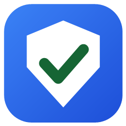
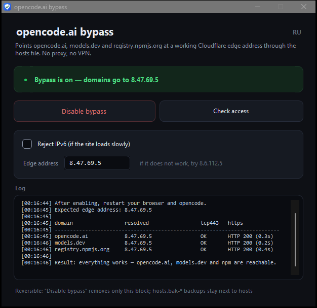
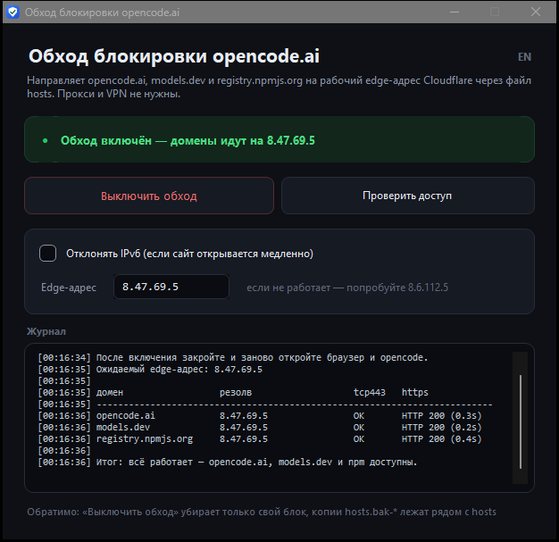

<div align="center">



# OpencodeDpiFix

**One tiny exe that restores access to opencode.ai, models.dev and registry.npmjs.org
when your ISP blocks them at the TLS handshake.**

[](https://github.com/d1m40fficial/opencode-dpi-fix/releases/latest)
[](https://github.com/d1m40fficial/opencode-dpi-fix/releases/latest)
[](https://github.com/d1m40fficial/opencode-dpi-fix/releases/latest)
[](LICENSE)

[Русский](README.md) · [English](README.en.md)

</div>

| English | Русский |
|---|---|
|  |  |

The interface speaks two languages: the **RU / EN** switch sits in the top-right corner and
the choice is remembered.

---

## Why

Some ISPs (Rostelecom in Russia, for one) started dropping connections to `opencode.ai`:
the website is unreachable, the app cannot list models, npm cannot install packages.
A VPN is overkill, a proxy is a hassle.

The tool fixes it in one click and affects **everything at once**: the browser, the opencode
app, the CLI, npm. No background process, no service, no proxy settings.

---

## The gist

The ISP does not filter by hostname and not by IP address: it drops the connection based on
the contents of the TLS handshake. At the same time the same Cloudflare is reachable on
several addresses, and the rule is not applied to all of them.

| Scenario | Where the request goes | Result |
|---|---|---|
| No bypass | `172.65.90.x` — the default Cloudflare address | ✂ the DPI resets the connection |
| With bypass | `8.47.69.5` — the same Cloudflare, another edge | ✓ HTTP 200 |

The handshake is identical in both cases — only the address it goes to changes.

The tool writes three lines into `hosts` so the browser, the app and npm go to an address
where the rule does not fire.

This is **not a proxy and not a VPN**: traffic goes straight to the same Cloudflare, only the
entry address changes. The domains, the certificate, the SNI and the content stay the same,
so nothing has to be reconfigured in any app and the connection stays just as fast.

---

## Quick start

1. Download **`OpencodeDpiFix.exe`** from the [latest release](https://github.com/d1m40fficial/opencode-dpi-fix/releases/latest).
2. Double-click → click **Yes** in the UAC prompt (editing `hosts` requires administrator rights).
3. Press **Enable bypass** and restart your browser and opencode.

That's it. The same button turns into **Disable bypass** once the bypass is on — one click
restores everything. Next to it, **Check access** reports DNS resolution, TCP 443 and the
HTTPS response for each domain.

---

## What it changes

A marked block is appended to `C:\Windows\System32\drivers\etc\hosts`:

```text
# --- DPI bypass: opencode / models.dev / npm ---
8.47.69.5	opencode.ai
8.47.69.5	models.dev
8.47.69.5	registry.npmjs.org
# --- end ---
```

- Running it again replaces the block — no duplicates.
- Before every write a copy `hosts.bak-<timestamp>` is stored next to `hosts`.
- The rest of the file is left untouched.
- **Disable bypass** deletes exactly that block and flushes the DNS cache.

---

## Why it works

A bit more on the blocking itself. The DPI inspects the TLS ClientHello: if the client offers
a post-quantum key share (`X25519MLKEM768`, ~1.5 KB), the connection is silently reset.
Plain `X25519` to the very same address goes through.

`8.47.69.5` is the same Cloudflare edge, but the rule is not applied there — verified to serve
these hosts even with a PQ handshake. So instead of fighting the DPI, the tool simply points
the domains where it does not get in the way.

---

## Troubleshooting

| Symptom | Fix |
|---|---|
| Check shows errors, DNS is not `8.47.69.5` | The records did not apply: confirm UAC and enable again |
| Site loads slowly or not at all while IPv4 is fine | Your ISP has IPv6 — tick “Отклонять IPv6” and enable again |
| `8.47.69.5` stopped responding | Put the backup address `8.6.112.5` into the Edge address field |
| Neither address helps | The rule now covers every Cloudflare edge — only a VPN is left |
| SmartScreen: “Windows protected your PC” | More info → Run anyway; the exe is not code-signed |
| Antivirus flags an unknown exe | Sources are open: build it yourself, see below |

---

## Command line

The exe also works as a CLI — handy for scripts:

```console
OpencodeDpiFix.exe                       open the window
OpencodeDpiFix.exe install [--ipv6]      enable the bypass (admin required)
OpencodeDpiFix.exe install --ip 8.6.112.5
OpencodeDpiFix.exe revert                remove the records (admin required)
OpencodeDpiFix.exe check                 test all three domains
OpencodeDpiFix.exe status                print the current state
OpencodeDpiFix.exe check --lang ru       Russian output
```

Exit codes: `0` — success, `1` — problem or no records, `2` — bad arguments.

---

## Build from source

You only need Windows: the C# compiler shipped with .NET Framework is already there.
No NuGet, no SDK, no internet access required.

```powershell
powershell -ExecutionPolicy Bypass -File build.ps1
```

The result is `dist\OpencodeDpiFix.exe` (WinForms, .NET Framework 4.8, ~93 KB).
The icon is generated by `tools/make-icon.ps1`. CI and releases live in
[GitHub Actions](.github/workflows/build.yml).

<details>
<summary>Project layout</summary>

| Path | Purpose |
|---|---|
| `src/HostsFix.cs` | `hosts` editing: install, revert, state, backups |
| `src/NetworkCheck.cs` | DNS, TCP 443 and HTTPS checks for the three domains |
| `src/MainForm.cs` | The window |
| `src/Ui.cs` | Dark theme: cards, buttons, checkbox |
| `src/Cli.cs` | Command line commands |
| `src/Strings.cs` | Every string in Russian and English |
| `src/Program.cs` | Entry point, console attach, UAC elevation |
| `src/app.manifest` | `requireAdministrator` + DPI aware |
| `build.ps1` | Builds the exe |
| `legacy/` | Original `.cmd`/`.ps1` scripts this tool grew from |

</details>

<details>
<summary>Environment variables (tests and CI only)</summary>

| Variable | Effect |
|---|---|
| `OPENCODE_DPI_FIX_HOSTS` | override the hosts file path |
| `OPENCODE_DPI_FIX_ALLOW_NONADMIN=1` | skip the administrator check |

</details>

---

## Honest caveats

- This is **not** a general-purpose unblocker: it restores access to the three domains
  opencode needs and nothing else.
- It is a workaround, not a guarantee: the ISP may extend the rule to every Cloudflare edge,
  and then only a VPN will help.
- Editing `hosts` affects the whole system. If corporate DNS or local rules rely on these
  domains, check for conflicts first.
- Not affiliated with the opencode team or with any ISP.

## License

[MIT](LICENSE). Take it and do whatever you want.
