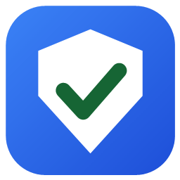
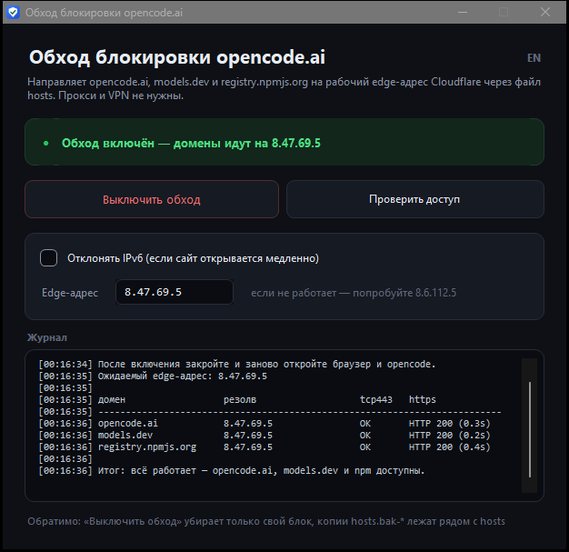
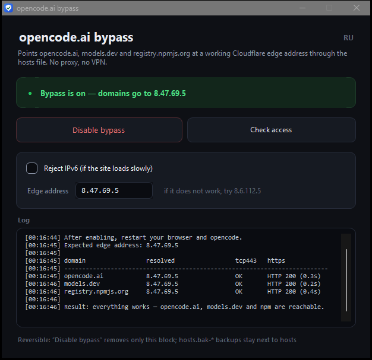

<div align="center">



# OpencodeDpiFix

**Один exe, который возвращает доступ к opencode.ai, models.dev и registry.npmjs.org,
когда провайдер блокирует их по TLS-рукопожатию.**

[](https://github.com/d1m40fficial/opencode-dpi-fix/releases/latest)
[](https://github.com/d1m40fficial/opencode-dpi-fix/releases/latest)
[](https://github.com/d1m40fficial/opencode-dpi-fix/releases/latest)
[](LICENSE)

[Русский](README.md) · [English](README.en.md)

</div>

| Русский | English |
|---|---|
|  |  |

Интерфейс на двух языках: переключатель **RU / EN** в правом верхнем углу, выбор запоминается.

---

## Зачем это

Провайдер (например, Ростелеком) начал рвать соединения с `opencode.ai`: сайт не открывается,
приложение не видит модели, npm не ставит пакеты. VPN ставить не хочется, прокси настраивать лень.

Утилита за один клик прописывает три домена на рабочий edge-адрес Cloudflare в системный
файл `hosts`. Это действует сразу на **всё**: браузер, приложение opencode, CLI, npm.
Никаких фоновых процессов, служб и настроек прокси.

---

## Быстрый старт

1. Скачайте **`OpencodeDpiFix.exe`** из [последнего релиза](https://github.com/d1m40fficial/opencode-dpi-fix/releases/latest).
2. Двойной клик → в запросе UAC **«Да»** (правка `hosts` требует прав администратора).
3. Нажмите **«Включить обход»** и перезапустите браузер и opencode.

Готово. Кнопка та же: когда обход включён, она называется **«Выключить обход»** —
одно нажатие возвращает всё как было. Рядом — **«Проверить доступ»**: резолв, TCP 443
и ответ HTTPS по каждому из трёх доменов.

---

## Что именно меняется

В `C:\Windows\System32\drivers\etc\hosts` добавляется блок с маркерами:

```text
# --- DPI bypass: opencode / models.dev / npm ---
8.47.69.5	opencode.ai
8.47.69.5	models.dev
8.47.69.5	registry.npmjs.org
# --- end ---
```

- Повторный запуск **не** создаёт дубликатов — старый блок заменяется новым.
- Перед каждой записью рядом с `hosts` сохраняется копия `hosts.bak-<дата-время>`.
- Остальное содержимое файла не трогается.
- Кнопка **«Выключить обход»** убирает ровно этот блок и сбрасывает кэш DNS.

---

## Почему это работает

DPI режет не по имени сайта и не по IP, а по содержимому TLS ClientHello: если клиент
предлагает post-quantum ключ (`X25519MLKEM768`, ~1.5 КБ), соединение молча сбрасывается.
Классический `X25519` на том же адресе проходит.

`8.47.69.5` — тот же Cloudflare, но правило на нём не применено: проверено, что он отдаёт
эти хосты даже с PQ-рукопожатием. Отсюда решение: не бороться с DPI, а просто направить
домены туда, где он не мешает.

---

## Если не работает

| Симптом | Что делать |
|---|---|
| «Проверить доступ» показывает ошибки, резолв не `8.47.69.5` | Записи не применились: подтвердите UAC и включите обход ещё раз |
| Сайт открывается медленно или не открывается при рабочем IPv4 | У провайдера есть IPv6 — поставьте галочку «Отклонять IPv6» и включите снова |
| `8.47.69.5` перестал отвечать | Введите в «Edge-адрес» резервный `8.6.112.5` и включите снова |
| Не помогают оба адреса | Правило накрыло все edge-адреса Cloudflare — остаётся только VPN |
| SmartScreen: «Windows защитила ваш компьютер» | «Подробнее» → «Выполнить в любом случае» — exe не подписан сертификатом |
| Антивирус ругается на неизвестный exe | Исходники открыты, соберите сами: `powershell -ExecutionPolicy Bypass -File build.ps1` |

---

## Командная строка

Exe понимает и консольные команды — удобно для скриптов:

```console
OpencodeDpiFix.exe                       открыть окно
OpencodeDpiFix.exe install [--ipv6]      включить обход (нужен администратор)
OpencodeDpiFix.exe install --ip 8.6.112.5
OpencodeDpiFix.exe revert                удалить записи (нужен администратор)
OpencodeDpiFix.exe check                 проверить доступность доменов
OpencodeDpiFix.exe status                показать состояние записей
OpencodeDpiFix.exe check --lang en       по-английски
```

Коды возврата: `0` — успех, `1` — проблема или записей нет, `2` — неверные параметры.

---

## Сборка из исходников

Нужен только Windows: компилятор C# из состава .NET Framework уже установлен в системе.
Ни NuGet, ни SDK, ни интернета не требуется.

```powershell
powershell -ExecutionPolicy Bypass -File build.ps1
```

Результат — `dist\OpencodeDpiFix.exe` (WinForms, .NET Framework 4.8, ~82 КБ).
Иконка генерируется скриптом `tools/make-icon.ps1`. Автосборка и релизы — в
[GitHub Actions](.github/workflows/build.yml).

<details>
<summary>Структура проекта</summary>

| Путь | Назначение |
|---|---|
| `src/HostsFix.cs` | Правка `hosts`: установка, удаление, состояние, резервные копии |
| `src/NetworkCheck.cs` | Резолв, TCP 443 и HTTPS-проверка трёх доменов |
| `src/MainForm.cs` | Окно программы |
| `src/Ui.cs` | Тёмная тема: карточки, кнопки, галочка |
| `src/Cli.cs` | Консольные команды |
| `src/Strings.cs` | Все тексты на русском и английском |
| `src/Program.cs` | Точка входа, консоль, запрос прав администратора |
| `src/app.manifest` | `requireAdministrator` + DPI-aware |
| `build.ps1` | Сборка exe |
| `legacy/` | Исходные `.cmd`/`.ps1`-скрипты, из которых выросла утилита |

</details>

<details>
<summary>Переменные окружения (только для тестов и CI)</summary>

| Переменная | Действие |
|---|---|
| `OPENCODE_DPI_FIX_HOSTS` | подменить путь к файлу hosts |
| `OPENCODE_DPI_FIX_ALLOW_NONADMIN=1` | не требовать права администратора |

</details>

---

## Честные оговорки

- Утилита **не** «обходит блокировки вообще»: она возвращает доступ только к трём доменам,
  нужным opencode. Остальные заблокированные сайты она не трогает.
- Это обход по существу, а не гарантия: провайдер может расширить правило на все
  edge-адреса Cloudflare, и тогда поможет только VPN.
- Правка `hosts` действует на всю систему. Если на этих доменах завязан корпоративный
  DNS или локальные правила — сначала проверьте, что они не конфликтуют.
- Проект не связан с командой opencode и не аффилирован с провайдерами.

## Лицензия

[MIT](LICENSE). Берите и делайте что хотите.
